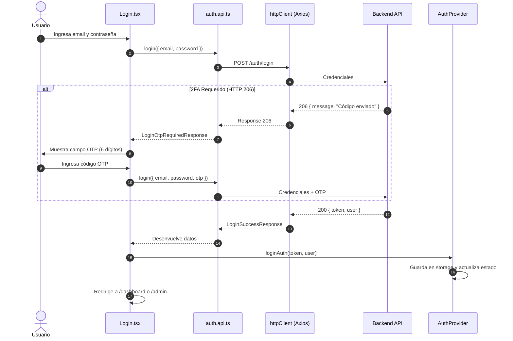

# Contexto del Frontend — Sistema de Rutas de Aprendizaje EPN (ESFOT)

> **Documento de Contexto Técnico para Agentes IA y Desarrolladores**  
> **Versión del Proyecto:** v3.0 SaaS (ESFOT - Escuela Politécnica Nacional)  
> **Última Verificación del Código:** Noviembre 2026  
> **Estado de Calidad:** 🟢 100% TypeScript estricto (`allowJs: false`) | 22 suites de test / 150 tests pasando en Vitest | 0 errores de compilación (`tsc --noEmit`).

---

## 1. Visión General del Frontend

El frontend de **Rutas EPN** es una Single Page Application (SPA) educativa, moderna y reactiva diseñada para los estudiantes y docentes/administradores de la Escuela Politécnica Nacional (ESFOT). Su propósito es guiar el aprendizaje en asignaturas tecnológicas mediante:

1. **Rutas de Aprendizaje Curriculares y Adaptativas:** Secuencias pedagógicas de módulos y recursos didácticos (PDFs, videos, enlaces) optimizadas por prerrequisitos.
2. **Motor de Autodiagnóstico Basado en Grafos (Neo4j):** Evaluación del nivel de conocimiento tema por tema para generar rutas personalizadas ajustadas a las necesidades reales del estudiante.
3. **Tutor Virtual Inteligente con GraphRAG (Google Gemini):** Asistente pedagógico contextualizado en el grafo de conocimiento que resuelve dudas, evalúa código y propone retos prácticos guiados.
4. **Espacio de Programación Integrado:** Editor Monaco con compilación/ejecución remota en múltiples lenguajes (JDoodle) y envío directo de soluciones al tutor IA.
5. **Gamificación y Analítica:** Puntos de experiencia (XP), niveles, rachas de estudio y métricas visuales de progreso curricular.

### Roles en la Interfaz
- **`STUDENT`**: Explora rutas públicas, realiza autodiagnóstico, sigue sus rutas inscritas/personalizadas, resuelve cuestionarios generados por IA, programa en el workspace, consulta al tutor y revisa analíticas.
- **`ADMIN`**: Gestiona usuarios (activación, bloqueo, desbloqueo), administra la biblioteca digital de recursos educativos, construye rutas de aprendizaje públicas con módulos y recursos asociados, y gestiona roles.

---

## 2. Stack Tecnológico

| Capa / Herramienta | Tecnología | Versión | Propósito / Configuración Clave |
|---|---|---|---|
| **Librería UI** | React | `19.2.6` | Modo concurrente, StrictMode, `createRoot`, componentes funcionales con hooks |
| **Lenguaje** | TypeScript | `7.0.2` | Configuración estricta (`strict: true`, `allowJs: false`, paths `@/*` hacia `src/*`) |
| **Build Tool & DevServer** | Vite | `8.0.12` | HMR instantáneo, proxy `/api` hacia `http://localhost:3000` |
| **Enrutamiento** | React Router DOM | `7.15.1` | `BrowserRouter`, rutas protegidas por rol, lazy loading con `Suspense` |
| **Estilos & Diseño** | Tailwind CSS | `4.3.0` | `@tailwindcss/postcss`, temas con `@theme` en `index.css`, Dark Mode por clase `.dark` |
| **Formularios & Validación** | React Hook Form + Zod | `7.75.0` / `4.4.3` | Schemas Zod con `@hookform/resolvers/zod` en Login, Admin, Builder |
| **Cliente HTTP** | Axios | `1.16.1` | `httpClient.ts` centralizado, interceptores Bearer Token, auto-logout en 401 |
| **Editor de Código** | Monaco Editor | `@monaco-editor/react 4.7.0` | Editor web profesional en `CodeWorkspace` para C++, Python, JS, Java |
| **Gráficos & Analítica** | Recharts | `3.10.1` | Barras, líneas y donas en `AnalyticsDashboard` |
| **Renderizado Markdown** | React Markdown | `10.1.0` | Renderizado seguro de respuestas del Chatbot y contenido de rutas |
| **Notificaciones** | React-Toastify | `11.1.0` | Alertas flotantes accesibles en acciones asíncronas |
| **Iconografía** | React Icons | `5.6.0` | Lucide, Material (`react-icons/md`, `react-icons/fi`, `fa`, `hi`) |
| **Testing** | Vitest + Testing Library | `5.0.3` / `16.3.3` | Entorno `jsdom`, `@testing-library/jest-dom`, 150 tests unitarios/integración |
| **Linters & Formateo** | ESLint + Oxlint | `10.3.0` / `1.89.0` | Doble verificación de sintaxis y reglas de hooks React |

---

## 3. Estructura Exhaustiva del Proyecto (`Frontend/src`)

```
Frontend/src/
├── main.tsx                         # Punto de entrada React 19 (createRoot con guard de #root)
├── App.tsx                          # Definición de rutas, Providers, Suspense y ToastContainer
├── index.css                        # Tailwind v4 @theme, paletas brand/primary/surface, dark variant
├── vite-env.d.ts                    # Declaraciones de tipos para import.meta.env (VITE_API_URL)
│
├── api/                             # Capa de comunicación con el Backend (100% tipada, 0 Axios en UI)
│   ├── httpClient.ts                # Instancia de Axios configurada, interceptor de token y de 401
│   ├── normalize.ts                 # Normalización de datos: IDs enteros de Turso/SQLite a strings
│   ├── normalize.test.ts            # Tests unitarios para la normalización de entidades
│   ├── errors.ts                    # getApiErrorMessage: unifica errores heterogéneos { message } / { error }
│   ├── index.ts                     # Barrel export centralizado: importar todo desde '@/api'
│   ├── admin.api.ts                 # getUsers, createUser, updateUser, toggleUserStatus, unlockUser
│   ├── analytics.api.ts             # getWeeklyActivity
│   ├── auth.api.ts                  # login, register, getProfile, changePassword, verifyAccount, etc.
│   ├── chat.api.ts                  # sendChatMessage, generateAssessment
│   ├── execute.api.ts               # runCode (comunicación con JDoodle vía Backend)
│   ├── graph.api.ts                 # getSubjects, getSubjectTopics, submitSelfDiagnosis, generateAdaptiveRoute
│   ├── resource.api.ts              # getResources, createResource, updateResource, deleteResource
│   ├── route.api.ts                 # getRoutes, getRouteById, getMyRoutes, enrollRoute, completeModule
│   ├── route.api.test.ts            # Cobertura de funciones de rutas
│   └── upload.api.ts                # uploadFile, uploadProfileImage, uploadCoverImage (Cloudinary)
│
├── types/
│   └── index.ts                     # Contratos de datos globales de la aplicación (~530 líneas documentadas)
│
├── context/
│   ├── AuthContext.ts               # Contexto React de autenticación y tipos AuthState / AuthContextValue
│   ├── AuthProvider.tsx             # Provider con hidratación lazy desde sessionStorage/localStorage
│   └── AuthProvider.test.tsx        # Tests de login, logout y persistencia
│
├── hooks/
│   └── useAuth.ts                   # Custom hook para acceder a AuthContext con guard de provider
│
├── routes/
│   ├── PrivateRoute.tsx             # Guardián de rutas protegidas por roles (allowedRoles)
│   ├── PrivateRoute.test.tsx        # Tests de redirección y permisos
│   ├── PublicRoute.tsx              # Redirección automática de usuarios autenticados a /dashboard
│   └── PublicRoute.test.tsx         # Tests de rutas públicas
│
├── components/ui/                   # Sistema de diseño atómico reutilizable
│   ├── index.ts                     # Barrel export de componentes UI (importar desde '@/components/ui')
│   ├── Badge.tsx (+ .test.tsx)      # Variantes de etiquetas de estado
│   ├── Button.tsx (+ .test.tsx)     # Botones primarios, secundarios, peligro, ghost con estados de carga
│   ├── Card.tsx                     # Card, CardHeader, CardBody
│   ├── ConfirmDialog.tsx (+ .test)  # Modal accesible de confirmación para acciones críticas
│   ├── Input.tsx (+ .test.tsx)      # Campo de texto controlado con label, error e icono
│   └── Spinner.tsx                  # Indicador de carga animado SVG
│
├── pages/
│   ├── Landing.tsx                  # Página pública principal (Navbar, Hero, Features, CTA, Footer)
│   ├── NotFound.tsx                 # Error 404 con redirección
│   ├── Unauthorized.tsx             # Error 403 con enlace de retorno
│   │
│   ├── auth/                        # Vistas de autenticación y gestión de accesos
│   │   ├── Login.tsx (+ .test.tsx)         # Inicio de sesión con soporte 2FA (código OTP)
│   │   ├── Register.tsx                    # Registro de estudiantes con dominios permitidos
│   │   ├── Confirm.tsx                     # Verificación de cuenta por token
│   │   ├── Forgot.tsx (+ .test.tsx)        # Solicitud de recuperación de contraseña
│   │   ├── Reset.tsx (+ .test.tsx)         # Restablecimiento de contraseña mediante token
│   │   └── UnlockAccount.tsx (+ .test.tsx) # Desbloqueo de cuentas bloqueadas por intentos fallidos
│   │
│   ├── StudentDashboard/            # Panel completo del Estudiante
│   │   ├── index.tsx (+ .test.tsx)  # Orquestador del estudiante: pestañas, tema, estado de rutas
│   │   ├── components/
│   │   │   ├── StudentHeader.tsx    # Barra superior con nivel, XP actual, foto y perfil
│   │   │   ├── StudentSidebar.tsx   # Menú lateral colapsable con accesos y botón de autodiagnóstico
│   │   │   ├── DashboardHome.tsx    # Resumen general: bienvenida, racha, accesos directos
│   │   │   ├── RouteExplorer.tsx    # Catálogo de rutas públicas disponibles para inscripción
│   │   │   ├── RoutesViewer.tsx     # "Mis Rutas": listado de rutas inscritas y personalizadas
│   │   │   ├── RouteDetails.tsx     # Detalle de la ruta: alternancia Teoría/Práctica y orquestación
│   │   │   ├── route-details/       # Subcomponentes modulares del detalle de ruta:
│   │   │   │   ├── RouteHeader.tsx  # Portada, progreso en porcentaje, dificultad, tiempo
│   │   │   │   ├── ModuleList.tsx   # Acordeón de módulos en secuencia pedagógica
│   │   │   │   ├── ModuleItem.tsx   # Item individual con estado de aprobación y recursos
│   │   │   │   └── ResourceCard.tsx # Tarjeta de recurso con enlace externo o visor
│   │   │   ├── AIAssessmentForm.tsx # Cuestionario generado por IA con feedback inmediato y XP
│   │   │   ├── CodeWorkspace.tsx    # Monaco Editor, compilador JDoodle, envío de código al Tutor
│   │   │   ├── Chatbot.tsx          # Tutor virtual flotante integrado con el Grafo (GraphRAG)
│   │   │   ├── SelfDiagnosisModal.tsx # Modal de autodiagnóstico tema por tema (escala 1 a 5)
│   │   │   ├── Recommendations.tsx  # Materias afines recomendadas según el grafo curricular
│   │   │   ├── AnalyticsDashboard.tsx # Gráficos de actividad, progreso por materia y distribución
│   │   │   └── StudentProfile.tsx   # Consulta y edición de datos personales, avatar y contraseña
│   │
│   └── AdminDashboard/              # Panel de Control Administrativo
│       ├── index.tsx (+ .test.tsx)  # Orquestador del administrador: pestañas y carga de perfil
│       ├── components/
│       │   ├── AdminHeader.tsx      # Barra superior administrativa
│       │   ├── AdminSidebar.tsx     # Menú lateral administrativo
│       │   ├── AdminHome.tsx        # Métricas globales de la plataforma
│       │   ├── UsersManager.tsx     # Contenedor de gestión de usuarios
│       │   ├── UsersTable.tsx       # Tabla de usuarios con filtros y acciones
│       │   ├── UserFormModal.tsx    # Modal de creación y edición de usuarios con validación EPN
│       │   ├── ResourcesManager.tsx # Catálogo y CRUD de materiales didácticos
│       │   ├── ResourceBuilder.tsx  # Formulario con subida de archivos (PDF/Imágenes a Cloudinary)
│       │   ├── RoutesManager.tsx    # Listado y control de rutas públicas
│       │   ├── RouteBuilder.tsx     # Creador visual de rutas: orden de módulos, recursos y portada
│       │   ├── RoleManager.tsx      # Asignación y revocación de roles
│       │   └── AdminProfile.tsx     # Perfil del administrador y cambio de avatar
│
├── utils/
│   ├── email.ts                     # Validación y normalización de correos (@epn.edu.ec y @gmail.com)
│   └── progress.ts                  # levelProgress: cálculo puro de XP en nivel y porcentaje (1000 XP/nivel)
│
└── test/
    └── setup.ts                     # Configuración de Vitest (@testing-library/jest-dom/vitest)
```

---

## 4. Arquitectura de Estado y Flujos de Datos

### 4.1 Autenticación y Sesión Global (`AuthContext`)
- **Almacenamiento dual seguro:** `sessionStorage` (prioritario para aislamiento por pestaña) con fallback a `localStorage`.
- **Hidratación Lazy:** El estado se inicializa sincrónicamente en la función de inicialización de `useState(readStoredAuth)`. Esto elimina *flashes* de pantalla y evita que `PrivateRoute` redirija al usuario a `/login` durante un refresco con F5.
- **Normalización de Usuario:** Al recuperar la sesión del almacenamiento, se garantiza que `user.id` sea un `string`, evitando discrepancias numéricas de SQLite.
- **Flujo de 2FA (OTP):**
  - Si el usuario tiene habilitado OTP o el backend detecta un inicio sospechoso, el endpoint `/auth/login` responde HTTP `206 Partial Content` con `{ message: "Ingresa el código OTP..." }`.
  - El cliente HTTP de Axios tiene `validateStatus: (status) => status >= 200 && status < 300`, por lo que el `206` **no lanza error**.
  - `Login.tsx` detecta la respuesta mediante `!isLoginSuccess(res)`, activa el campo de 6 dígitos `otp` y solicita al usuario el código sin borrar sus credenciales.
- **Interceptor de Expiración:** `httpClient.ts` intercepta cualquier error HTTP `401 Unauthorized`, limpia de inmediato `token` y `user` de ambos almacenamientos y redirige a `/login`.



### 4.2 Capa API y Desempaquetado Centralizado
**Regla de oro del proyecto:** Ningún componente React consume `axios` o `httpClient` directamente. Toda petición pasa por un archivo `src/api/*.api.ts`.

1. **Desenvolvimiento de respuestas:** El backend envía estructuras con envolturas como `{ success: true, route: {...} }` o `{ success: true, subjects: [...] }`. Cada función de `*.api.ts` extrae la propiedad interna y retorna el dato limpio y tipado.
2. **Normalización de IDs (`src/api/normalize.ts`):** En SQLite (Turso) los IDs de llaves primarias son enteros numéricos (`1`, `2`, `42`). El frontend tipa los IDs como `string`. Para evitar errores en `enrolledRouteIds.includes(route.id)` o comparaciones de igualdad estricta (`===`), `normalizeRoute`, `normalizeModule` y `normalizeResource` convierten todos los `id` a string en el borde de la API.
3. **Manejo Centralizado de Errores (`src/api/errors.ts`):** `getApiErrorMessage(error, fallback)` extrae mensajes tanto de `error.response.data.error` como de `error.response.data.message` o errores de red.

---

## 5. Módulos Funcionales y Casos de Uso Clave

### 5.1 Autodiagnóstico Curricular y Rutas Personalizadas (HU-013, HU-014)
- **Componente:** `src/pages/StudentDashboard/components/SelfDiagnosisModal.tsx`.
- **Funcionamiento:**
  1. Consulta las asignaturas piloto disponibles mediante `getSubjects()` (`redes`, `web`).
  2. Al seleccionar una asignatura, carga los módulos y sus temas con `getSubjectTopics(subjectId)`.
  3. Los módulos se muestran en pestañas horizontales para no saturar la vista.
  4. Para cada tema, el estudiante califica su conocimiento de 1 a 5:
     - `1`: Sin conocimiento | `2`: Básico/Teórico | `3`: Intermedio | `4`: Práctico | `5`: Avanzado.
  5. **Mecanismo anti-trampa `touched`:** El botón "Generar Mi Ruta Adaptativa" permanece deshabilitado hasta que el usuario haya calificado activamente los temas.
  6. Al enviar, llama a `submitSelfDiagnosis()` y luego a `generatePersonalizedAdaptiveRoute()`.
  7. El backend procesa el grafo en Neo4j AuraDB aplicando ordenamiento topológico (algoritmo de Kahn) y genera una ruta adaptativa (`difficulty: 'ADAPTIVE'`).
  8. La interfaz refresca la lista de rutas del alumno y cambia automáticamente a la pestaña "Mis Rutas".

### 5.2 Visualizador y Ejecutor de Rutas (`RouteDetails.tsx`) (HU-011, HU-012)
- **Modos de Vista:**
  - **Teoría:** Muestra el listado secuencial de módulos (`ModuleList`, `ModuleItem`) y sus recursos educativos (`ResourceCard`). Los módulos aprobados se identifican mediante `isPassed: true`.
  - **Práctica:** Muestra el espacio de programación interactivo (`CodeWorkspace`).
- **Inscripción Dinámica:** Si el estudiante entra a una ruta pública donde no está inscrito, se muestra el botón "Inscribirme en esta Ruta", disparando `enrollRoute(routeId)` y actualizando el estado local.
- **Evaluaciones con Inteligencia Artificial (`AIAssessmentForm.tsx`):**
  - El alumno puede pulsar en "Evaluar Módulo con IA" (modalidades: *Completa*, *Teoría*, o *Práctica*).
  - El backend consulta a Google Gemini, que devuelve un cuestionario contextualizado.
  - El formulario evalúa las respuestas en el cliente.
  - Si la calificación es $\ge 70\%$, envía `completeModule({ moduleId, score, passed: true })`, otorgando XP en vivo, actualizando la barra de nivel y refrescando el progreso de la ruta.
  - Si es $< 70\%$, envía `passed: false` para registrar la telemetría de dificultad en Neo4j y permitir reforzar los temas débiles.

### 5.3 Espacio de Código (`CodeWorkspace.tsx`)
- Integra `@monaco-editor/react` con tema oscuro.
- Lenguajes soportados: Python, C++, Java, JavaScript, HTML, SQL, Bash.
- Compilación y ejecución en la nube mediante `runCode()` (puente hacia JDoodle).
- Soporte para **retos multi-tarea** (`challengeData.tasks`): pestañas independientes por cada ejercicio, permitiendo alternar entre código fuente o subida de ficheros de evidencia.
- Botón **"Enviar al Tutor IA"**: construye un prompt pedagógico estructurado con el reto, el código del alumno y la salida de la consola, transfiriéndolo directamente al `Chatbot`.

### 5.4 Tutor Virtual con GraphRAG (`Chatbot.tsx`) (HU-015)
- Asistente flotante permanente en el dashboard del estudiante.
- **Inyección de contexto curricular:**
  - Detecta la ruta activa y el módulo donde se encuentra el estudiante.
  - Consulta `getModuleTopics()` y `getTopicGraphContext()` para recuperar el nodo exacto del tema en Neo4j con sus prerrequisitos y temas que desbloquea.
  - Envía la conversación junto con el `topicId` a `sendChatMessage()`.
- Soporta subida de capturas o documentos (`uploadFile`) para consultas visuales.
- El tutor puede emitir retos prácticos personalizados y cargar automáticamente el contexto de evaluación en el `CodeWorkspace`.

### 5.5 Panel Administrativo (`AdminDashboard`)
- **Gestión de Usuarios (`UsersManager`, `UsersTable`, `UserFormModal`):**
  - Búsqueda en tiempo real por nombre y correo.
  - Cambio de estado activo/inactivo (`toggleUserStatus`).
  - Desbloqueo manual de cuentas bloqueadas por fuerza bruta (`unlockUser`).
  - Validación de dominios permitidos: solo correos `@epn.edu.ec` y `@gmail.com`.
- **Biblioteca de Recursos (`ResourcesManager`, `ResourceBuilder`):**
  - Alta, baja y edición de recursos pedagógicos.
  - Carga de archivos físicos a Cloudinary (`uploadFile`).
- **Constructor de Rutas Públicas (`RouteBuilder.tsx`):**
  - Formulario con Zod (`routeSchema`): título, descripción, categoría, tiempo estimado, dificultad y reglas de evaluación para la IA.
  - Subida y previsualización de portada de ruta (`uploadCoverImage`) con validación de tipo MIME y tamaño máximo de 5MB.
  - Editor interactivo de módulos: agregar, reordenar y vincular recursos didácticos existentes desde el catálogo.

---

## 6. Modelos de Dominio Principales (`src/types/index.ts`)

### Usuario y Sesión
```typescript
export interface User {
  id: string;
  name: string;
  email: string;
  roles: string[];
  initials?: string;
  learningProfile?: string | null;
  profilePicture?: string | null;
  xp?: number;
  level?: number;
  streak?: number;
  nextRankXp?: number;
  isActive?: boolean;
  isLocked?: boolean;
}

export interface UserDashboard extends User {
  primaryRole: 'ADMIN' | 'STUDENT';
}
```

### Rutas, Módulos y Progreso
```typescript
export type Difficulty = 'BEGINNER' | 'INTERMEDIATE' | 'ADVANCED' | 'ADAPTIVE';

export interface Resource {
  id: string;
  title: string;
  url: string;
  type: 'PDF' | 'VIDEO' | 'LINK' | 'IMAGE';
  description?: string;
  subject?: string;
}

export interface Module {
  id: string;
  title: string;
  description?: string | null;
  position?: number;
  routeId?: string;
  isPassed?: boolean;     // IMPORTANTE: en BD es isPassed, NO completed
  score?: number | null;
  resources?: Resource[];
}

export interface LearningRoute {
  id: string;
  title: string;
  description?: string | null;
  category?: string | null;
  subjectId?: string | null;
  imageUrl?: string | null;
  estimatedTime?: number | null;
  difficulty?: Difficulty;
  isPublic?: boolean | number;
  authorId?: string;
  modules?: Module[];
  progress?: number;      // 0 a 100 calculado por el backend
}
```

### Grafo Curricular y GraphRAG
```typescript
export interface Subject {
  id: string;             // 'redes' | 'web'
  name: string;
  moduleCount?: number;
  topicCount?: number;
}

export interface GraphTopic {
  id: string;
  name: string;
  description?: string | null;
  difficulty?: number | string | null;
  prerequisites?: { id: string; name: string; strength: 'HARD' | 'SOFT' }[];
  resources?: Resource[];
}

export interface GraphModule {
  id: string;
  name: string;
  position: number;
  topics: GraphTopic[];
}
```

---

## 7. Gotchas y Reglas Críticas (Must-Know para Agentes)

> [!WARNING]
> Lee estas reglas antes de tocar código en el frontend para evitar regresiones críticas.

1. **Normalización de IDs (SQLite vs Neo4j vs TypeScript):**  
   En Turso/SQLite los IDs son numéricos (`INTEGER PRIMARY KEY`), pero en Neo4j y en los tipos del frontend son `string`. **Siempre** usa las funciones de `src/api/normalize.ts` al recibir datos del backend. Nunca asumas que `route.id` viene como string desde el JSON crudo del cable.
2. **Propiedad de Aprobación de Módulos (`isPassed` vs `completed`):**  
   El backend escribe en la tabla `ModuleProgress` la columna `isPassed`. Históricamente un error común era leer `module.completed` (que siempre era `undefined`), haciendo que las barras de progreso y los contadores de analítica mostraran siempre cero.
3. **Normalización Estricta de Correos (`normalizeEmail`):**  
   SQLite realiza búsquedas de `TEXT` de manera sensible a mayúsculas (`Case-Sensitive`). Si un usuario se registra como `Estudiante@epn.edu.ec` y el backend almacena `estudiante@epn.edu.ec`, el login fallará si no se normaliza. Usa siempre `normalizeEmail()` de `src/utils/email.ts` antes de enviar formularios de autenticación o administración.
4. **Respuesta HTTP 206 (OTP Requerido) en Login:**  
   El endpoint `/auth/login` devuelve código HTTP `206` si la cuenta exige un segundo factor. Axios no debe fallar en este status. Se debe revisar `isLoginSuccess(res)` para determinar si se recibió el token final o si se debe pedir el código de 6 dígitos.
5. **Generación de Rutas Personalizadas:**  
   Los estudiantes **no** tienen botón manual para crear rutas arbitrarias. La ruta personalizada adaptativa solo se puede generar completando el autodiagnóstico en `SelfDiagnosisModal.tsx`.
6. **Pureza en Callbacks de `setState`:**  
   En React 19 (StrictMode), los callbacks actualizadores de estado (`setUserData(prev => ...)`) pueden ejecutarse dos veces en desarrollo. **Nunca** invoques escrituras a `localStorage` o `sessionStorage` dentro del actualizador; hazlo en efectos o en el manejador del evento.
7. **Cálculo de Niveles y Gamificación:**  
   El backend calcula el nivel como `Math.floor(xp / 1000) + 1` (cada nivel cuesta exactamente `1000 XP`). Usa `levelProgress(xp, level)` de `src/utils/progress.ts` para renderizar el porcentaje de la barra; no dividas la XP acumulada directamente.

---

## 8. Comandos de Desarrollo y Testing

Ejecuta todos los comandos desde el directorio `Frontend/` o usando el prefijo `--prefix Frontend`:

```bash
# Iniciar servidor de desarrollo en http://localhost:5173
npm --prefix Frontend run dev

# Verificación de tipos con TypeScript (0 errores obligatorios)
npm --prefix Frontend run typecheck

# Ejecución de la suite completa de pruebas con Vitest
npm --prefix Frontend test

# Ejecución de pruebas en modo interactivo / watch
npm --prefix Frontend run test:watch

# Análisis estático de código con ESLint y Oxlint
npm --prefix Frontend run lint

# Corrección rápida de linter con Oxlint
npm --prefix Frontend run lint:fix

# Compilar para producción en dist/
npm --prefix Frontend run build

# Previsualizar el build de producción
npm --prefix Frontend run preview
```

### Configuración del Entorno de Pruebas (`vitest.config.ts`)
- Entorno: `jsdom`.
- Setup file: `Frontend/src/test/setup.ts` (importa `@testing-library/jest-dom/vitest`).
- Soporte de CSS activo (`css: true`).
- Alias configurado: `@/` apunta a `Frontend/src/`.

---

## 9. Variables de Entorno

Archivo: `Frontend/.env` (o variables en plataforma de hosting):

| Variable | Descripción | Valor Local Típico | Valor Producción Típico |
|---|---|---|---|
| `VITE_API_URL` | URL base de la API backend | `http://localhost:3000/api` | `https://esfotroutes.onrender.com/api` |

> [!NOTE]
> En Vite, el archivo `vite.config.ts` tiene un proxy configurado para redirigir peticiones `/api` a `http://localhost:3000` durante el desarrollo local, evitando problemas de CORS.

---

## 10. Roadmap y Tareas de Mejora Técnica (Backlog para Agentes)

Para futuras tareas o refactorizaciones sugeridas en `Frontend/C.md`:

1. **Migración a Deep Linking en Dashboards (Alta prioridad):**
   - Actualmente las secciones de los dashboards usan estado local `useState<StudentTab>('inicio')` y `useState<AdminTab>('inicio')`.
   - *Mejora recomendada:* Usar rutas anidadas con React Router (`/dashboard/:tab` y `/admin/:tab`) con `useParams`. Esto habilitará historial de navegación nativo, botón atrás/adelante del navegador y enlaces directos.
2. **Adopción de TanStack Query (React Query):**
   - Reducir los múltiples `useEffect` de fetching dispersos en los dashboards (`loadProfile`, `fetchAvailableRoutes`, `fetchMyRoutes`).
   - Brindará caché automático en memoria, deduplicación de llamadas y reintentos automáticos.
3. **Feature Contexts para Desacoplar Prop Drilling:**
   - En `RouteDetails.tsx` convergen múltiples props hacia `CodeWorkspace`, `AIAssessmentForm` y `ModuleList`.
   - Se recomienda crear un `RouteDetailContext` para compartir el estado de la ruta y la evaluación sin encadenar props.
4. **Estandarización de Imports a Alias `@/`:**
   - Gran parte del código usa imports relativos (`../../api/...`). Migrar progresivamente a `@/api`, `@/components/ui`, etc., facilitado por la configuración existente de Vite y tsconfig.
