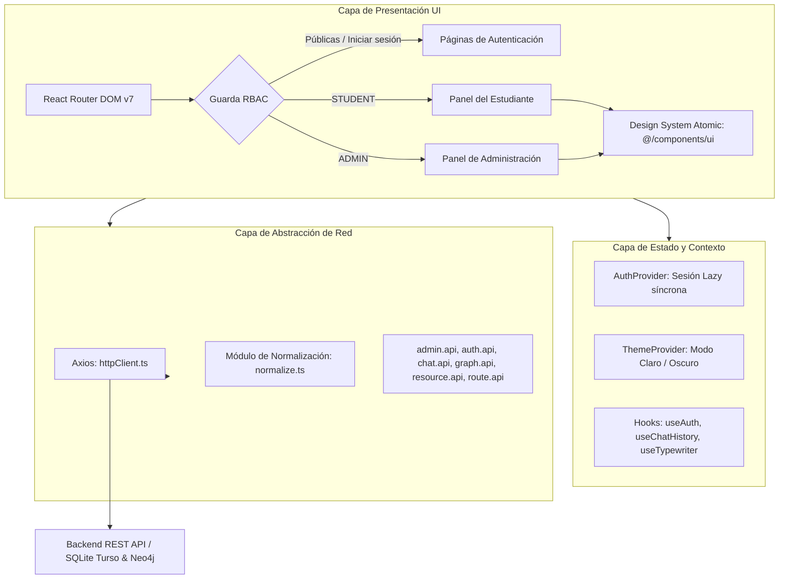

# Contexto Técnico y Arquitectura del Frontend (RUTAS V3)

> **Documento Canónico de Especificación Técnica del Frontend**  
> **Versión**: 3.2 (Arquitectura SaaS / React 19 + TypeScript + Tailwind CSS v4)  
> **Ámbito**: Sistema Web de Rutas de Aprendizaje Adaptativas con Soporte de Inteligencia Artificial y Grafos de Conocimiento (Neo4j)  
> **Institución**: Escuela Politécnica Nacional (EPN) — Escuela de Formación de Tecnólogos (ESFOT)

---

## 1. Ficha Técnica y Stack Tecnológico

El frontend está desarrollado bajo una arquitectura moderna de Component-Driven Development (CDD) con tipado estricto en TypeScript, compilación optimizada con Vite y gestión reactiva del estado.

| Componente | Tecnología | Versión | Rol en el Sistema |
| :--- | :--- | :--- | :--- |
| **Framework Base** | React | `^19.2.6` | Motor de interfaz reactiva, concurrencia y renderizado declarativo |
| **Tipado Estático** | TypeScript | `^7.0.2` | Tipado estático estricto, contratos de dominio e interfaces de red |
| **Bundler / DevServer** | Vite | `^8.0.12` | Entorno de desarrollo con HMR instantáneo y build de producción |
| **Estilos y Tokens** | Tailwind CSS / PostCSS | `^4.3.0` | Utilidades CSS de bajo nivel, paleta corporativa EPN y modo oscuro |
| **Enrutador SPA** | React Router DOM | `^7.15.1` | Navegación del cliente, rutas protegidas (RBAC) y carga diferida (*lazy loading*) |
| **Formularios y Esquemas** | React Hook Form + Zod | `^7.75.0` / `^4.4.3` | Gestión de formularios, resolución declarativa de esquemas y validaciones |
| **Cliente HTTP** | Axios | `^1.16.1` | Interceptor de peticiones, inyección automática de token y normalización |
| **Editor de Código** | Monaco Editor React | `^4.7.0` | Editor profesional embebido para resolución de retos prácticos de programación |
| **Visualización Gráfica** | Recharts | `^3.10.1` | Métricas y gráficos de progreso estudiantil (radar, barras, actividad semanal) |
| **Procesador Markdown** | React Markdown | `^10.1.0` | Renderizado seguro de Markdown pedagógico en el Tutor IA del Chatbot |
| **Motor de PDF** | jsPDF + jsPDF-AutoTable | `^4.2.1` / `^5.0.9` | Generación dinámica de reportes académicos institucionales con membrete |
| **Iconografía** | Lucide Icons (React Icons) | `^5.6.0` | Iconografía vectorial SVG coherente; estándar de **cero emojis** en la UI |
| **Suite de Pruebas** | Vitest + Testing Library | `^5.0.3` / `^16.3.3` | **52 suites de pruebas (337 tests pasando al 100%)** con entorno JSDOM |

### Scripts Operativos (`package.json`)
* `npm run dev`: Inicia el servidor de desarrollo local en Vite con HMR.
* `npm run build`: Compilación de producción (`tsc -b && vite build`) con optimización de chunks.
* `npm run typecheck`: Validación de tipos sin emitir código (`tsc --noEmit`).
* `npm test`: Ejecución de pruebas unitarias y de integración con Vitest (`vitest run`).
* `npm run lint` / `npm run lint:fix`: Análisis estático de código con ESLint y Oxlint.

---

## 2. Arquitectura de Software y Principios de Diseño



### Principios Fundamentales:
1. **Single Source of Truth para Identificadores (SQLite Turso Normalization)**:
   En SQLite / Turso, los identificadores son numéricos (`INTEGER PRIMARY KEY`), pero el dominio frontend opera con strings estrictos. La frontera `src/api/normalize.ts` normaliza transparentemente todos los `id` a `string`, previniendo bugs de comparación `===` entre números y cadenas.
2. **Cero Emojis en la UI Institucional**:
   Toda la interfaz emplea exclusivamente iconos vectoriales a través del wrapper semántico `<Icon name="..." />` respaldado por Lucide. No se utilizan emojis decorativos en botones, tarjetas ni encabezados.
3. **Gestión Defensiva de Sesión e Hidratación Libre de Carreras**:
   `AuthProvider.tsx` implementa inicialización síncrona mediante lazy-initializer de `useState` leyendo de `sessionStorage`/`localStorage`. Esto previene deslogueos indeseados en recargas duras (F5) y elimina renders flash de estado desautenticado.
4. **Manejo de Errores Tipado y Desacoplado**:
   `src/api/errors.ts` provee `getApiErrorMessage(error, fallback)` que inspecciona Axios errors, códigos de estado HTTP y respuestas de validación (`error.response.data.message` o `.error`), retornando siempre mensajes claros en español.

---

## 3. Sistema de Enrutamiento, Seguridad y Control de Acceso (RBAC)

El árbol de rutas está centralizado en [Frontend/src/App.tsx](file:///c:/Users/Alexa/Desktop/ProyectoWeb-RUTASV3/Frontend/src/App.tsx):

```tsx
<ThemeProvider>
  <BrowserRouter>
    <AuthProvider>
      <ThemedToastContainer />
      <Suspense fallback={<PageLoader />}>
        <Routes>
          {/* Públicas generales */}
          <Route path="/" element={<Landing />} />
          <Route path="/confirm/:token" element={<Confirm />} />
          <Route path="/desbloquear-cuenta/:token" element={<UnlockAccount />} />

          {/* Rutas de autenticación (restringidas si ya está logueado) */}
          <Route element={<PublicRoute />}>
            <Route path="/login" element={<Login />} />
            <Route path="/register" element={<Register />} />
            <Route path="/forgot" element={<Forgot />} />
            <Route path="/reset-password/:token" element={<Reset />} />
          </Route>

          {/* Rutas protegidas por Rol */}
          <Route element={<PrivateRoute allowedRoles={['STUDENT']} />}>
            <Route path="/dashboard" element={<StudentDashboard />} />
          </Route>

          <Route element={<PrivateRoute allowedRoles={['ADMIN']} />}>
            <Route path="/admin" element={<AdminDashboard />} />
          </Route>

          <Route path="/unauthorized" element={<Unauthorized />} />
          <Route path="*" element={<NotFound />} />
        </Routes>
      </Suspense>
    </AuthProvider>
  </BrowserRouter>
</ThemeProvider>
```

### Roles Oficiales del Sistema:
* **`STUDENT` (Estudiante)**: Acceso restringido al portal formativo (`/dashboard`).
* **`ADMIN` (Administrador)**: Acceso a la consola de administración académica (`/admin`).
* *(El rol `TEACHER` fue formalmente eliminado del sistema en req.md, API y frontend para alinearse al alcance real de la plataforma).*

---

## 4. Detalle Exhaustivo de Vistas y Formularios

### 4.1 Módulo de Autenticación (`src/pages/auth/`)

#### A. Inicio de Sesión (`Login.tsx`)
* **Librerías**: `react-hook-form`, `@hookform/resolvers/zod`, `zod`.
* **Esquema de Validación (`loginSchema`)**:
  * `email`: Obligatorio, formato email válido, restringido a dominios institucionales (`@epn.edu.ec`) o Gmail (`@gmail.com`). Normalización automática a minúsculas (`normalizeEmail`).
  * `password`: Obligatorio, no vacío.
* **Características UX**:
  * Toggle para ver/ocultar contraseña (icono `MdVisibility` / `MdVisibilityOff`).
  * Notificaciones de error inline dentro de la tarjeta (no flotantes) que persisten hasta que el usuario corrige los campos.
  * Manejo de parámetros query: `?verified=true` (cuenta activada exitosamente) y `?error=invalid_token`.
  * Redirección reactiva post-login: Administradores a `/admin`, estudiantes a `/dashboard`.

#### B. Registro de Estudiantes (`Register.tsx`)
* **Campos del Formulario**:
  1. `firstName` y `lastName`: Nombres y apellidos concatenados para enviar `name`.
  2. `email`: Correo institucional (`@epn.edu.ec` o `@gmail.com`).
  3. `password`: Contraseña de acceso con toggle de visibilidad.
  4. `career`: Selector de carreras oficiales de la ESFOT (`CAREERS`):
     * *Desarrollo de Software*
     * *Redes y Telecomunicaciones*
     * *Electromecanica*
     * Opción *OTRA* que habilita campo de texto libre `customCareer`.
  5. `semester`: Entero del 1 al 5 (`SEMESTERS`).
  6. `uniqueId`: Identificador único numérico EPN, validado estrictamente a **exactamente 9 dígitos numéricos** (`/^\d{9}$/`).
* **Feedback y Transición**:
  * Mensaje de éxito inline indicando que se envió el correo de activación.
  * Espera de 2.5 segundos con botón en estado de carga antes de redirigir a `/login`.

#### C. Confirmación de Cuenta (`Confirm.tsx`)
* **Ruta**: `/confirm/:token`
* **Lógica**: Lee el parámetro `:token`, ejecuta `verifyAccount(token)` de forma idempotente mediante `useRef(false)` (evita doble petición en StrictMode de React), presenta tarjeta de bienvenida y redirige a `/login`.

#### D. Recuperación y Restablecimiento de Contraseña (`Forgot.tsx` y `Reset.tsx`)
* **`Forgot.tsx`**: Solicita `email`, despacha `forgotPassword(email)` y muestra confirmación segura sin revelar la existencia del correo en la base de datos.
* **`Reset.tsx` (`/reset-password/:token`)**: Solicita `newPassword` y confirmación de contraseña, validando longitud mínima de 8 caracteres y coincidencia exacta antes de invocar `resetPassword(token, data)`.

#### E. Desbloqueo de Cuentas (`UnlockAccount.tsx`)
* **Ruta**: `/desbloquear-cuenta/:token`
* **Lógica**: Maneja el desbloqueo tras bloqueo por 5 intentos fallidos consecutivos. Realiza `unlockAccount(token)` sobre el endpoint del backend y ofrece acceso directo a la plataforma.

---

### 4.2 Panel de Administración (`src/pages/AdminDashboard/`)

El panel de administración cuenta con barra lateral de navegación (`AdminSidebar.tsx`), cabecera (`AdminHeader.tsx`) y 6 pestañas principales (`navigation.ts`):

```typescript
export type AdminTab = 'inicio' | 'usuarios' | 'recursos' | 'rutas' | 'constructor' | 'perfil';
```

#### A. Resumen Operativo (`AdminHome.tsx`)
* **Objetivo**: Métricas ejecutivas en tiempo real.
* **Indicadores**:
  * Total de usuarios registrados y activos.
  * Total de rutas de aprendizaje públicas creadas.
  * Total de recursos didácticos en biblioteca.
  * Accesos rápidos a creación de usuarios, nuevo recurso o constructor de rutas.

#### B. Gestión de Usuarios (`UsersManager.tsx` y `UsersTable.tsx`)
* **Filtros y Búsqueda**:
  * Buscador textual reactivo por nombre o correo institucional.
  * Filtro por rol: `TODOS`, `ESTUDIANTES` (`STUDENT`), `ADMINISTRADORES` (`ADMIN`).
  * Filtro por estado: `TODOS`, `ACTIVOS`, `INACTIVOS`, `BLOQUEADOS`.
* **Exportación de Reportes**:
  * Botón *"Exportar PDF"*: Invoca `exportUsersPdf(filteredUsers, summary)` generando informe con membrete oficial EPN/ESFOT y tabla formateada con autoTable.
* **Acciones por Fila**:
  * **Ver detalle / Progreso**: Abre `UserProgressModal.tsx`.
  * **Activar / Desactivar**: Despliega modal de confirmación accesible previo (`ConfirmDialog.tsx`) antes de mutar la cuenta vía `toggleUserStatus(userId)`.
  * **Desbloquear Cuenta**: Despliega confirmación previa antes de desbloquear cuentas bloqueadas por seguridad (`unlockUser(userId)`).
  * **Editar Usuario**: Abre `UserFormModal.tsx` con los datos cargados.

#### C. Modal de Creación y Edición de Usuario (`UserFormModal.tsx`)
* **Formulario**:
  * `name`: Nombre completo (mínimo 3 caracteres).
  * `email`: Correo institucional (`@epn.edu.ec` o `@gmail.com`).
  * `password`: Contraseña (mínimo 8 caracteres, obligatoria al crear, opcional al editar).
  * `roleName`: Selector exclusivo entre `STUDENT` (Estudiante) y `ADMIN` (Administrador).
  * `career`: Selector de carreras oficiales de la ESFOT u otra personalizada.
  * `semester`: Selector numérico 1 a 5.
  * `uniqueId`: ID único institucional de 9 dígitos numéricos.
* **Modo Operativo**: Soporta creación (`createUser`) o edición (`updateUser`).

#### D. Modal de Progreso del Estudiante (`UserProgressModal.tsx`)
* **Datos Generales**: Nombre, correo, carrera, semestre, ID único, **Fecha de registro** y **Último acceso** al sistema.
* **Métricas Formativas**: Puntos de experiencia (XP), Nivel acumulado, Racha de días, Módulos completados, Módulos aprobados, Promedio ponderado y Rutas inscritas.
* **Tabla de Rutas del Estudiante**:
  * Nombre de la ruta, categoría, fecha de inscripción y porcentaje de avance (barra progresiva).
  * **Botón de Eliminación Individual**: Permite al administrador eliminar una ruta de prueba específica mediante `deleteStudentEnrollment(userId, routeId)` con confirmación previa y feedback toast.
  * **Botón "Reiniciar todas las inscripciones"**: Limpia la totalidad de rutas del estudiante mediante `resetStudentEnrollments(userId)` con confirmación previa y toast.
  * **Botón "Exportar PDF"**: Descarga el informe individual oficial del estudiante mediante `exportStudentProgressPdf(progressData)`.

#### E. Gestión de Recursos Didácticos (`ResourcesManager.tsx` y `ResourceBuilder.tsx`)
* **Exploración**: Buscador en tiempo real por título o materia, selector de tipología (`PDF`, `VIDEO`, `LINK`, `IMAGE`, `DOCUMENT`).
* **Modal de Creación / Edición (`ResourceBuilder.tsx`)**:
  * `title`: Título del recurso didáctico.
  * `url`: Enlace directo o URL del archivo.
  * `type`: Tipo de medio (`PDF` | `VIDEO` | `LINK` | `IMAGE` | `DOCUMENT`).
  * `description`: Resumen pedagógico del contenido.
  * `subject`: Materia o asignatura vinculada (ej. *Desarrollo Web*, *Redes*).
* **Eliminación Segura**: Botón de eliminar con diálogo modal de confirmación accesible (`ConfirmDialog`) antes de ejecutar `deleteResource(id)`.

#### F. Gestión y Catálogo de Rutas (`RoutesManager.tsx`)
* **Listado de Rutas**: Cuadrícula de tarjetas con imagen de portada (`imageUrl`), título, categoría, badge de dificultad, conteo de módulos y horas estimadas.
* **Acciones Principales**:
  * *"Nueva Ruta"*: Abre el constructor manual (`RouteBuilder.tsx`).
  * *"Generar con IA"*: Abre el generador inteligente `GenerateRouteModal.tsx`.
  * *"Editar"*: Carga la ruta en `RouteBuilder` para edición.
  * *"Eliminar"*: Diálogo modal de confirmación antes de llamar a `deleteRoute(id)`.

#### G. Constructor de Rutas de Aprendizaje (`RouteBuilder.tsx`)
* **Metadatos Generales**:
  * `title`: Título de la ruta formativa.
  * `category`: Selector de 7 categorías de Software Engineering (`CATEGORIES_SOFTWARE_ENG`):
    * *Frontend Development*, *Backend Development*, *Full Stack & DevOps*, *Bases de Datos*, *Arquitectura de Software*, *Calidad y Testing*, *Ciberseguridad*.
  * `difficulty`: Selector entre `BEGINNER`, `INTERMEDIATE`, `ADVANCED`.
  * `estimatedTime`: Horas pedagógicas estimadas.
  * `description`: Descripción general del itinerario de aprendizaje.
  * `imageUrl`: Portada con soporte para subida directa de imagen vía `/upload/cover`.
  * `evaluationRules`: Prompt maestro para la calibración de retos y preguntas de IA.
* **Diseño y Reordenamiento de Módulos**:
  * Soporta creación y eliminación de módulos en memoria.
  * **Controles de Reordenamiento (`moveModule`)**: Botones interactivos con iconos de flecha arriba/abajo para permutar el orden de los módulos antes de persistir la ruta.
  * **Selector Inteligente de Recursos (`ModuleResourcePicker.tsx`)**: Modal inteligente con buscador en vivo, pestañas por tipo de recurso y chips interactivos para vincular recursos existentes de la biblioteca digital al módulo.

#### H. Generador Automatizado con IA (`GenerateRouteModal.tsx`)
* **Campos**:
  * `topic`: Tema o asignatura de la ruta.
  * `difficulty`: Dificultad pedagógica sugerida.
  * `subjectId`: Materia curricular del grafo (`redes` o `web`).
  * `additionalContext`: Indicaciones complementarias para el modelo.
  * `file`: Archivo didáctico adjunto opcional (`.pdf`, `.txt`, `.md`).
* **Lógica**: Invoca `generateRouteWithAI(payload)` enviando `multipart/form-data` a `/routes/generate`.

---

### 4.3 Panel del Estudiante (`src/pages/StudentDashboard/`)

Pestañas de navegación (`navigation.ts`):
```typescript
export type StudentTab = 'inicio' | 'explorar' | 'mis-rutas' | 'recursos' | 'analytics' | 'perfil';
```

#### A. Centro de Mando / Inicio (`DashboardHome.tsx` y `Recommendations.tsx`)
* **`DashboardHome.tsx`**:
  * Hero con saludo personalizado y avatar institucional.
  * Medidor de Gamificación: Nivel actual derivado con `calculateLevel(xp)`, barra de progreso porcentual del nivel (`levelProgress`), racha de días y XP acumulado.
  * Tarjetas de estado con acceso directo a continuar la última ruta activa.
* **`Recommendations.tsx` (Recomendaciones del Grafo de Conocimiento Neo4j)**:
  * Consulta a `GET /api/graph/recommendations` (`getGraphRecommendations()`).
  * **Renderizado condicional silencioso**: Si el backend devuelve lista vacía (`items.length === 0`), el componente retorna `null` y no deja espacios vacíos.
  * **Tarjetas de Afinidad**: Despliega materias con porcentaje de afinidad (`item.matchScore% de afinidad`), justificación pedagógica (`item.reason`) y botón *"Explorar"*.

#### B. Explorador de Rutas Públicas (`RouteExplorer.tsx`)
* **Catálogo**: Despliega las rutas públicas disponibles en la plataforma.
* **Filtros**: Por categoría temática y por nivel de dificultad.
* **Banner de Autodiagnóstico**: Invoca el modal `SelfDiagnosisModal.tsx`.
* **Inscripción**: Botón *"Inscribirme"* que llama a `enrollRoute(routeId)` y transiciona a la pestaña *Mis Rutas*.

#### C. Autodiagnóstico Temático Inicial (`SelfDiagnosisModal.tsx`)
* **Lógica**:
  * Consulta módulos y temas curriculares de la materia en Neo4j vía `getSubjectTopics(subjectId)`.
  * Presenta temas agrupados con selector de dominio cualitativo en 4 niveles (1: "No lo conozco", 2: "Básico", 3: "Intermedio", 4: "Avanzado").
  * Barra de progreso de completitud del autodiagnóstico.
  * Envía las respuestas mediante `submitSelfDiagnosis(diagnoses)`.
  * Ofrece generación inmediata de ruta adaptativa personalizada mediante `generatePersonalizedAdaptiveRoute(subjectId)`.

#### D. Mis Rutas de Aprendizaje (`RoutesViewer.tsx`)
* **Colección del Estudiante**: Lista las rutas en las que el alumno está matriculado (`getMyRoutes()`).
* **Badges Distintivos**: Identifica visualmente rutas "Pública", "Adaptativa" (originada por autodiagnóstico en Neo4j) y "Personalizada IA".
* **Progreso Visual**: Barra porcentual de avance y botón para ingresar a la secuencia didáctica (`RouteDetails.tsx`).

#### E. Secuencia Didáctica de la Ruta (`RouteDetails.tsx`)
* **Encabezado Dinámico (`RouteHeader.tsx`)**:
  * Muestra título, categoría, dificultad y la barra de avance integral calculada con la **fórmula 60/40**.
* **Lista de Módulos (`ModuleList.tsx` y `ModuleItem.tsx`)**:
  * Desglose secuencial de módulos con estado de superación (`isPassed`), teoría aprobada (`passedTheory`) y reto final (`passedPractice`).
* **Tarjetas de Recursos (`ResourceCard.tsx`)**:
  * Apertura interactiva del material didáctico.
  * Al hacer clic por primera vez, dispara `openResource(resourceId)`:
    * Se añade el recurso al conjunto de abiertos de la ruta.
    * Se otorgan **+10 XP** con notificación toast informativa (*"¡Recurso abierto! (+10 pts de experiencia)"*).
    * Se actualiza reactivamente la barra de progreso sin recargar la página.
    * Si ya fue abierto, se abre sin duplicar XP ni emitir toast redundante.
* **Evaluaciones de Módulo (`ModuleAssessmentsModal.tsx` y `AIAssessmentForm.tsx`)**:
  * Cuestionarios interactivos de opción múltiple con retroalimentación instantánea.
  * Umbral aprobatorio: **≥ 70%**.
  * Al aprobar, se ejecuta `completeModule({ moduleId, score, passed: true })`, actualizando los niveles de XP del estudiante y aportando al 40% del avance de la ruta.

#### F. Catálogo Estudiantil de Recursos Didácticos (`ResourcesCatalog.tsx`)
* **Objetivo**: Biblioteca digital para consulta de materiales didácticos (117+ recursos).
* **Carga Progresiva por Lotes**:
  * Tamaño de lote: `BATCH_SIZE = 12`.
  * Despliega inicialmente 12 tarjetas y botón *"Cargar más recursos"* que suma 12 tarjetas por interacción sin recargar.
  * Contador dinámico: *"Mostrando X de Y recursos disponibles"*.
* **Buscador Reactivo en Memoria**:
  * Filtrado con latencia 0 ms sobre el título y descripción.
  * Filtro por tipo de recurso (`PDF`, `VIDEO`, `LINK`, `IMAGE`, `DOCUMENT`).
  * Reinicio automático al primer lote al cambiar términos de búsqueda o filtros.

#### G. Tutor Virtual IA y Chatbot (`Chatbot.tsx`)
* **Contexto GraphRAG Temático**:
  * Al cambiar de módulo o ruta, consulta en Neo4j los temas curriculares asociados (`getModuleTopics`) y el subgrafo local (`getTopicGraphContext`), inyectando contexto semántico preciso al asistente.
* **Efecto Máquina de Escribir (`TypewriterMarkdown.tsx` y `useTypewriter.ts`)**:
  * Las nuevas respuestas de la IA se muestran progresivamente con animación adaptativa.
  * Respuestas cortas avanzan carácter por carácter; respuestas extensas aceleran el flujo para concluir en un máximo de ~2.2 segundos.
  * Soporte nativo para accesibilidad `prefers-reduced-motion` (muestra el texto de golpe si está habilitado).
  * Posibilidad de hacer clic sobre la burbuja para saltar la animación al instante (*skip*).
  * Normalización preventiva de Markdown: si la animación corta a mitad de un bloque de código, cierra temporalmente los triple backticks para no romper el layout.
  * El botón *"Asignar como reto"* se habilita únicamente cuando el mensaje ha terminado de tipearse.
* **Historial de Sesiones (`ChatSessionDrawer.tsx` y `useChatHistory.ts`)**:
  * Drawer lateral para consultar conversaciones previas filtradas por módulo o globales.
  * Selección de sesión previa para rehidratación instantánea (los mensajes históricos se despliegan en 0 ms sin efecto typewriter).
  * Botón `+ Nuevo` para iniciar un hilo limpio.

#### H. Analítica del Estudiante (`AnalyticsDashboard.tsx`)
* Gráficos interactivos construidos con Recharts:
  * Avance porcentual por asignatura.
  * Minutos de actividad semanal con gráfico de barras.
  * Distribución de dedicación formativa.

#### I. Perfil del Estudiante (`StudentProfile.tsx`)
* Visualización de identidad, avatar con iniciales o fotografía personalizada (`/upload/profile-picture`).
* Nivel actual, barra de progreso a siguiente rango y total de XP.
* Formulario de actualización de datos (`updateProfile`) y cambio autenticado de contraseña (`changePassword`).

---

## 5. Modelos Matemáticos y Reglas de Negocio

### 5.1 Calibración de Niveles y Gamificación (`src/utils/progress.ts`)
Para asegurar una progresión pedagógica dinámica y gratificante frente a las recompensas de módulos (+25/+50 XP) y recursos (+10 XP), la escala está calibrada a **100 XP por nivel**:

$$\text{Nivel} = \left\lfloor \frac{\text{XP Total}}{100} \right\rfloor + 1$$

$$\text{XP en Nivel Actual} = \text{XP Total} - ((\text{Nivel} - 1) \times 100)$$

$$\text{Porcentaje al Siguiente Nivel} = \min\left(100, \text{round}\left(\frac{\text{XP en Nivel Actual}}{100} \times 100\right)\right)$$

### 5.2 Fórmula de Progreso de Ruta Híbrido 60/40 (`src/utils/routeProgress.ts`)
El avance integral de una ruta de aprendizaje combina el consumo de contenidos didácticos y la aprobación formal de evaluaciones:

$$\text{Progreso Total} = \text{Score Recursos (60\%)} + \text{Score Evaluaciones (40\%)}$$

Donde:
* **Score Recursos**:
  $$\text{Score Recursos} = \left( \frac{\text{Recursos Abiertos Únicos de la Ruta}}{\text{Total de Recursos Únicos de la Ruta}} \right) \times 60$$
* **Score Evaluaciones**:
  $$\text{Score Evaluaciones} = \left( \frac{\text{Evaluaciones Aprobadas}}{\text{Total de Evaluaciones Disponibles}} \right) \times 40$$
  *(El total de evaluaciones corresponde a $N$ cuestionarios teóricos de módulo más 1 reto práctico final).*
* El valor final se redondea a un entero entre 0 y 100 una sola vez al final del cálculo para evitar errores de redondeo acumulativo.

---

## 6. Sistema de Diseño, Tokens y Componentes UI (`src/components/ui/`)

El frontend implementa un catálogo de componentes atómicos reutilizables:

| Componente | Archivo | Responsabilidad y Características |
| :--- | :--- | :--- |
| **Avatar** | `Avatar.tsx` | Iniciales generadas por backend, soporte de foto de perfil y tamaños (`sm`, `md`, `lg`, `xl`) |
| **Badge** | `Badge.tsx` | Etiquetas de estado semánticas (`default`, `brand`, `primary`, `success`, `warning`, `danger`, `accent`) con opción de punto (`dot`) |
| **Button** | `Button.tsx` | Botones accesibles con variantes (`primary`, `secondary`, `outline`, `ghost`, `danger`) y estado `loading` con spinner |
| **Card** | `Card.tsx` | Contenedores modulares: `Card`, `CardHeader`, `CardBody`, `CardFooter` |
| **ConfirmDialog**| `ConfirmDialog.tsx` | Modal accesible de confirmación para acciones destructivas o críticas |
| **EmptyState** | `EmptyState.tsx` | Retroalimentación visual cuando filtros o búsquedas no arrojan resultados |
| **Icon** | `Icon.tsx` | Wrapper tipado de iconos Lucide SVG sin emojis |
| **Input** | `Input.tsx` | Entradas de texto estilizadas con estados de foco corporativos y mensajes de error |
| **Modal** | `Modal.tsx` | Diálogos modales con backdrop-blur, bloqueo de scroll, captura de foco y tecla Escape |
| **PageHeader** | `PageHeader.tsx` | Encabezados de sección con títulos tipográficos y acciones alineadas |
| **ProgressBar** | `ProgressBar.tsx` | Barra de progreso con gradiente y transiciones suaves |
| **Skeleton** | `Skeleton.tsx` | Placeholders animados para estados de carga en tablas, tarjetas y métricas |
| **Spinner** | `Spinner.tsx` | Indicador giratorio SVG para operaciones asíncronas |
| **StatCard** | `StatCard.tsx` | Tarjetas de indicadores numéricos con iconos semánticos y badges |
| **ThemedToast**| `ThemedToastContainer.tsx` | Contenedor de notificaciones toast adaptado a la paleta institucional y modo oscuro |
| **ThemeToggle**| `ThemeToggle.tsx` | Botón interactivo para alternar entre modo claro y oscuro |

---

## 7. Capa de Exportación Institucional a PDF (`src/utils/pdfExport.ts`)

La generación de documentos en formato PDF se ejecuta íntegramente en el cliente mediante carga dinámica (*code splitting*) de `jspdf` y `jspdf-autotable`, garantizando que las librerías solo se descarguen cuando el usuario pulsa el botón de exportación:

1. **Membrete Corporativo**:
   * Franja superior de acento en rojo institucional EPN (`#b91c1c` / `RGB: [185, 28, 28]`).
   * Tipografía Helvetica formal: *"ESCUELA POLITÉCNICA NACIONAL"* y *"ESFOT • Plataforma Rutas de Aprendizaje"*.
   * Pie de página automático con numeración *"Página X de Y"* y marca temporal de emisión (*"Generado el DD/MM/AAAA, HH:mm"*).
2. **Reportes Soportados**:
   * **Listado Consolidado de Usuarios (`exportUsersPdf`)**: Tabla estructurada con Nombre, Correo, Rol, Carrera, Semestre, Estado y Último Acceso, incluyendo resumen de filtros aplicados.
   * **Informe Individual de Progreso del Estudiante (`exportStudentProgressPdf`)**: Ficha académica del estudiante, métricas de rendimiento (XP, Nivel, Racha, Promedio, Evaluaciones) y desglose de rutas cursadas con porcentaje de avance.

---

## 8. Calidad de Código, Pruebas y Cobertura

La aplicación cuenta con una rigurosa batería de pruebas automatizadas mediante **Vitest** y **React Testing Library**:

* **Total de Suites de Prueba**: **52 archivos de test**
* **Total de Pruebas Unitarias e Integración**: **337 tests pasando (100% verde)**
* **Verificación de Tipos**: `tsc --noEmit` limpio (0 errores de tipado)
* **Principales Áreas Testeadas**:
  * Autenticación, flujo de tokens y recuperación de sesión (`Login.test.tsx`, `Register.test.tsx`, `Confirm.test.tsx`, `AuthProvider.test.tsx`).
  * Tablas administrativas, paginación, filtros y modales de confirmación (`UsersTable.test.tsx`, `UsersManager.test.tsx`, `UserFormModal.test.tsx`, `UserProgressModal.test.tsx`, `ResourcesManager.test.tsx`, `RoutesManager.test.tsx`).
  * Constructor de rutas, reordenamiento de módulos y smart resource picker (`RouteBuilder.test.tsx`, `ModuleResourcePicker.test.tsx`, `GenerateRouteModal.test.tsx`).
  * Algoritmos de gamificación y progreso 60/40 (`progress.test.ts`, `routeProgress.test.ts`).
  * Catálogo progresivo de recursos con carga en lotes de 12 y búsqueda instantánea (`ResourcesCatalog.test.tsx`).
  * Chatbot tutor con GraphRAG, historial persistente y efecto typewriter adaptativo (`Chatbot.test.tsx`, `ChatSessionDrawer.test.tsx`, `useTypewriter.test.ts`, `TypewriterMarkdown.test.tsx`).
  * Exportación de reportes PDF y utilidades UI (`pdfExport.test.ts`, `uiMaps.test.ts`, `Badge.test.tsx`, `Button.test.tsx`, `Modal.test.tsx`, `Input.test.tsx`).
